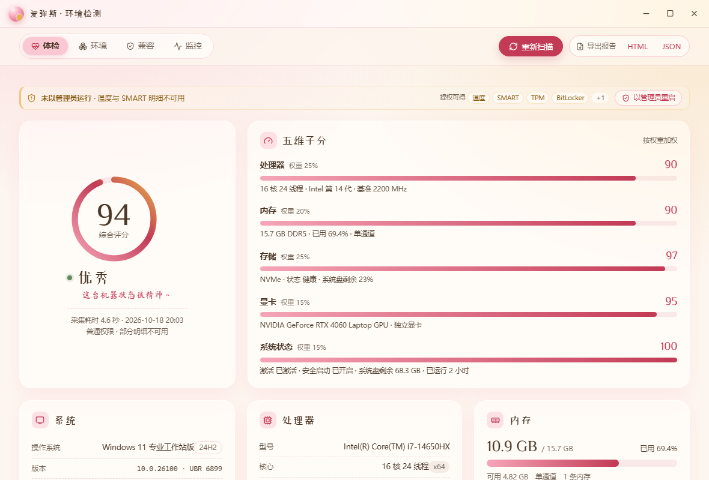
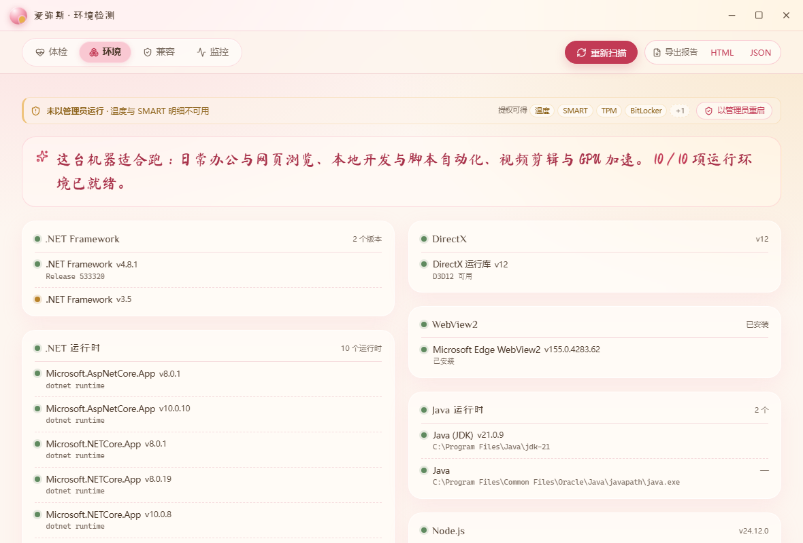
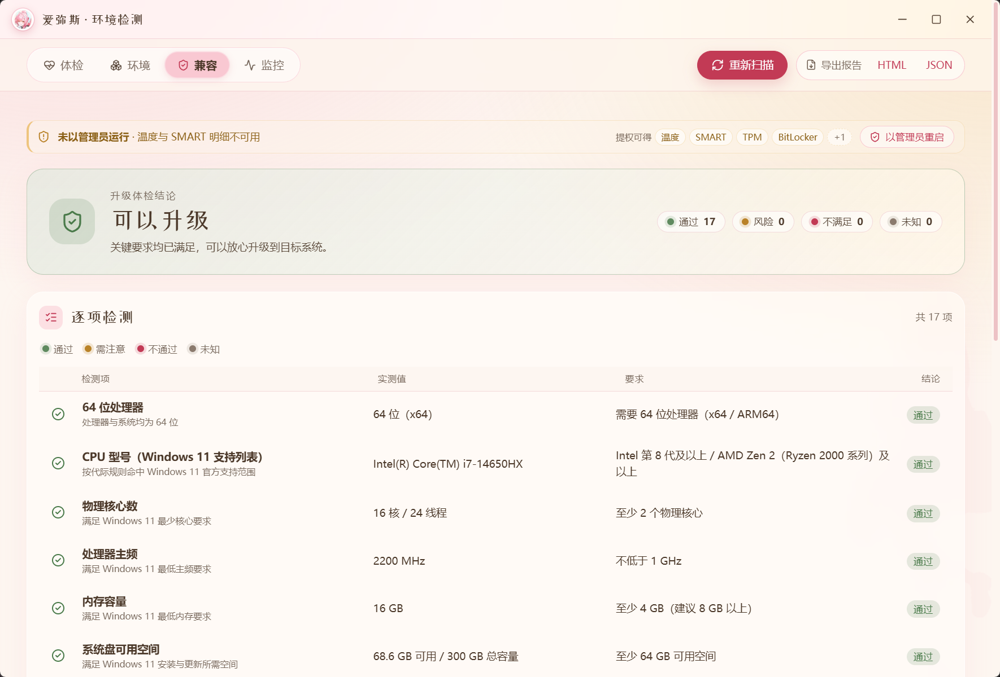
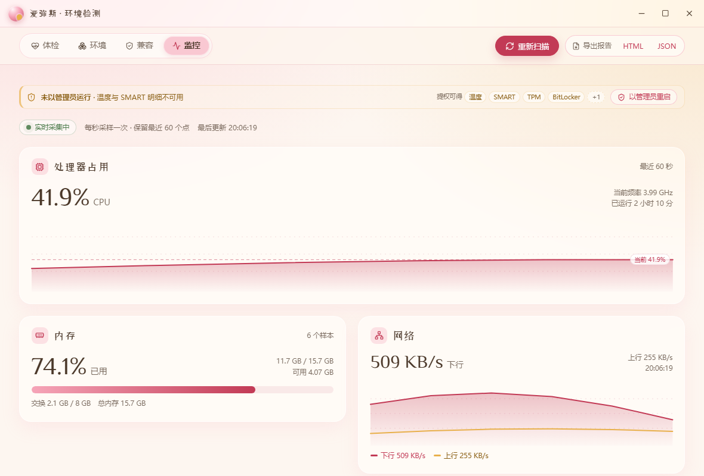

<div align="center">


# 爱弥斯 · 环境检测

**爱弥斯主题的 Windows 电脑环境检测工具 —— 单文件绿色版，双击就用，不装任何东西。**

Emis EnvCheck — a portable Windows PC environment inspector.
Hardware · Runtimes · Windows 11 compatibility · Live monitor. One `.exe`, no installer.

制作 **清吾** · [qingwu.ink](https://qingwu.ink) ｜ 主题形象 **爱弥斯**

[](https://github.com/hjphh11/emis-envcheck/releases)
[](https://github.com/hjphh11/emis-envcheck/releases)
[](https://github.com/hjphh11/emis-envcheck/releases)
[](https://tauri.app)

</div>

---

## 这是什么

把你的电脑「体检」一遍：硬件是什么、系统什么状态、装了哪些运行环境和软件、能不能升 Windows 11，
全部收在一屏玻璃卡里 —— 视觉沿用 [清吾](https://qingwu.ink) 博客的暖色二次元风格
（玫瑰粉 / 绯红 / 奶油白 / 琥珀金，玻璃拟态 + 克制动效），主角是主题形象 **爱弥斯**。

- 🟢 **绿色版**：单个 `.exe`，不写注册表、不装服务、不进开机启动，拷到 U 盘就能跑
- 🏥 **体检**：CPU / 内存 / 显卡 / 硬盘 / 主板 / 系统 / 网络 全量采集 + 0–100 健康评分
- 🧰 **环境**：.NET / VC++ / DirectX / WebView2 / Java / Node / Python / Git / WSL，
  外加 **MySQL、Redis、Docker、PostgreSQL…** 等第三方软件的安装与运行状态
- ✅ **兼容**：Windows 11 升级 17 项逐项判定，含 **显卡驱动** 与驱动时效检测
- 📈 **监控**：CPU 每核占用、内存、网络上下行，1 秒刷新的实时曲线
- 📄 **报告**：导出 HTML / JSON 报告，配置码一键复制
- ⌨️ **快捷键**：`Ctrl+R` 重扫、`Ctrl+E` 导出、`Ctrl+1~4` 切页签

## 看一眼

| 体检 | 环境 |
|---|---|
|  |  |

| 兼容 | 监控 |
|---|---|
|  |  |

| 关于 | 加载中 |
|---|---|
|  |  |

> 截图取自一台真实机器：i7-14650HX / 16GB DDR5 / RTX 4060 Laptop / 双屏。

## 四个页签

| 页签 | 你会看到 |
|---|---|
| **体检** | 健康评分环 + 五维子分（处理器/内存/存储/显卡/系统）+ 硬件详情卡 + 配置码 |
| **环境** | 运行库与开发环境清单 + **已安装软件**（数据库 / 容器 / Web 服务 / 语言 / 开发工具 / 常用软件） |
| **兼容** | Windows 11 升级 17 项：通过 / 警告 / 不通过 + 实测值 vs 要求 + 原因 |
| **监控** | CPU 总占用曲线 + 每逻辑核占用 + 内存 + 网络上下行，1 秒采样、保留 60 点 |

## 环境检测覆盖哪些软件

**运行库 / 框架**：.NET Framework（3.5 / 4.x 全版本）、.NET SDK & Runtime、VC++ 运行库（2005–2022 x86/x64）、
DirectX（版本 / d3d12 / 特性级别）、WebView2、Java（JDK / JRE）、Node.js、Python、Git、WSL、PowerShell

**第三方软件**（有就显示，没装就不出现）：

| 分类 | 检测对象 |
|---|---|
| 数据库 | MySQL、MariaDB、PostgreSQL、Redis、MongoDB、SQL Server、SQLite |
| 容器 / 虚拟化 | Docker Desktop（含引擎版本）、Podman、VirtualBox、VMware |
| Web 服务 | nginx、Apache、IIS |
| 语言 / 编译 | PHP、Go、Rust、.NET SDK、MSBuild、Android SDK、Ruby、Perl、MinGW |
| 开发工具 | Visual Studio、VS Code、JetBrains（IDEA / PyCharm / WebStorm…）、Maven、Gradle |
| 常用软件 | Steam、Microsoft Office、WPS、微信、QQ、网易云音乐、PotPlayer… |

每项都给出 **版本 / 安装路径 / 是否正在运行**（服务或进程），并标注检测来源。

## Windows 11 兼容性检测项（17 项）

64 位处理器 · CPU 型号在支持列表 · 物理核心数 · 主频 · 内存容量 · 系统盘容量（与可用空间）·
UEFI 固件 · 安全启动 · TPM 2.0 · DirectX 12 · WDDM 2.0 · 显示设备规格 ·
SSE4.2 / POPCNT 指令集 · 分区表 GPT · 操作系统版本 · **显卡驱动已安装（WDDM ≥ 2.0）** · **显卡驱动时效（< 18 个月）**

> 拿不到的项显示「未知」并说明原因，**绝不猜测成通过或不通过**。

## 下载与使用

1. 到 [Releases](https://github.com/hjphh11/emis-envcheck/releases/latest) 下载 `EmisEnvCheck-v1.3.1-portable.zip`（3.0 MB，内含 exe + 使用说明）
   —— 也可以直接下 `EmisEnvCheck-v1.3.1-windows-x64.exe`（6.1 MB）单文件
2. 解压后放到任意目录（桌面、U 盘、移动硬盘都行），双击（窗口标题显示「爱弥斯 · 环境检测」）
3. 首次会花 4–8 秒扫描，之后随开随用

> 想拿到温度、风扇转速、硬盘 SMART 明细、TPM 详情这些**深度数据**，需要管理员权限：
> 界面右上角有「以管理员重启」，点一下即可。普通权限也能用，只是对应项显示为不可用。

## 绿色版承诺

- 不写 `HKCU` / `HKLM` 注册表
- 不注册服务、不建计划任务、不写开机启动
- 不往自身目录写文件（临时采集脚本只落 `%TEMP%`，读完即删）
- 删掉 exe 就等于卸载干净
- **不联网上传任何数据**（唯一的外网动作是「连通性探测」的 ICMP ping）

## 技术栈

| 层 | 用什么 |
|---|---|
| 外壳 | **Tauri 2**（Rust）—— 单 exe，运行时用系统自带 WebView2 |
| 界面 | **React 19 + TypeScript + Tailwind CSS 4 + motion** |
| 采集 | **PowerShell 5.1**（WMI / CIM / 注册表 / 服务 / 常见目录扫描） |
| 实时 | **sysinfo** crate（CPU / 内存 / 网络 / 磁盘） |
| 字体 | 站酷小薇 + 马善政，**fontTools 子集化** 4.79MB → 542KB |
| 打包 | `tauri build --no-bundle` → 单文件 exe，无安装器 |

## 项目结构

```
hjjc/
├─ src/                       前端（React 19 + TS + Tailwind 4）
│  ├─ components/pages/       四个页签：体检 / 环境 / 兼容 / 监控
│  ├─ components/ui/          玻璃卡 / 评分环 / 折线 / 状态点 / Toast…
│  ├─ components/             标题栏 / 页签栏 / 工具条 / 骨架屏 / 页脚 / 关于面板
│  ├─ assets/fonts/           子集化后的两套中文字体（542KB）
│  ├─ assets/emis/            爱弥斯素材（头像 / 立绘 / 剪影）
│  ├─ lib/api.ts              Tauri 调用封装（浏览器里自动退回 mock）
│  ├─ lib/report.ts           自包含 HTML / JSON 报告模板
│  ├─ styles/                 tokens.css + fonts.css + app.css
│  └─ types.ts                数据契约（唯一真相）
├─ src-tauri/
│  ├─ src/                    Rust：scan_all / live_snapshot / 提权 / 写文件
│  └─ scripts/scan.ps1        PowerShell 采集器（2900+ 行，核心）
├─ dev/                       采集器工具链：texts.json / gen-texts / verify（860+ 项契约校验）
├─ docs/                      数据契约 / 检测项清单 / 参考调研 / 构建打包 / 截图
├─ scripts/
│  ├─ build-portable.ps1      一键出绿色版本 + zip + SHA256
│  ├─ subset-fonts.py         字体子集化（省 11.9MB）
│  ├─ capture-app.ps1         真机窗口截图
│  ├─ capture-tabs.ps1        真机四页签自动截图
│  └─ make-icon.py            应用图标生成（爱弥斯头像）
└─ assets/icon-source.png     图标源图（1024×1024）
```

## 本地开发

```powershell
# 纯前端预览（浏览器 + mock 数据，改样式最快）
npm install
npm run dev              # http://localhost:1420

# 桌面开发（需要 Rust 工具链 + WebView2）
npm run app:dev

# 出绿色版单文件 exe（含 zip + SHA256）
pwsh -File scripts\build-portable.ps1
```

前置：Node 18+ / Rust stable / WebView2（Win10 1803+ 一般自带）。
国内网络建议给 cargo 配 rsproxy 镜像、npm 用 npmmirror。
改了界面文案后记得 `python scripts/subset-fonts.py` 重新裁字体子集。

> CI：仓库里已备好 `.github/workflows/build.yml`（推 tag 自动构建 + 发 Release），
> 但推送 workflow 文件需要 GitHub token 带 `workflow` 权限，本地先执行
> `gh auth refresh -h github.com -s workflow` 后再 `git add .github/workflows/build.yml && git push`。

## 数据采集说明

- 采集脚本会在 `%TEMP%` 下落地一个临时 `.ps1` 和一个 `.json`，读完即删
- 所有数据只在本机内存里流转，不会上传到任何服务器
- 拿不到的字段一律返回 `null` 并在 `meta.warnings` 里说明原因，不会伪造数据
- 采集脚本是**纯 ASCII 源码 + Base64 中文文案块**，无论 PowerShell 按 ANSI 还是 UTF-8 解码都不会乱码

## 借鉴与致谢

产品结构参考了这些开源项目（详见 [docs/参考调研.md](docs/参考调研.md)）：

- [unupunct/SPECS](https://github.com/unupunct/SPECS) —— 单 exe 便携硬件诊断，功能矩阵与评分思路（MIT）
- [rcmaehl/WhyNotWin11](https://github.com/rcmaehl/WhyNotWin11) —— 逐项「通过/不通过 + 原因」的兼容性清单（GPL-3.0，仅借鉴思路）
- [Gexos/System-Info-Dashboard](https://github.com/Gexos/System-Info-Dashboard) —— 轻量看板布局
- [LibreHardwareMonitor](https://github.com/LibreHardwareMonitor/LibreHardwareMonitor) —— 传感器采集思路
- [systeminformation](https://github.com/sebhildebrandt/systeminformation) —— 硬件信息字段口径参照

界面设计 tokens 与爱弥斯素材来自同作者的博客项目 [清吾 qingwu.ink](https://qingwu.ink)。
字体：站酷小薇（ZCOOL XiaoWei）、马善政（Ma Shan Zheng），SIL Open Font License 1.1。
角色「爱弥斯」版权归《鸣潮》/ 库洛游戏所有，本项目为非商业同人作品。

## 许可

[MIT](LICENSE) © 清吾

---

<div align="center">

**如果这个东西帮你省了点事，去博客坐坐 ~** [qingwu.ink](https://qingwu.ink)

</div>
